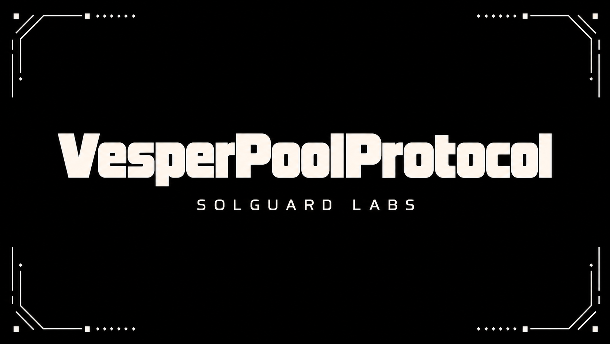
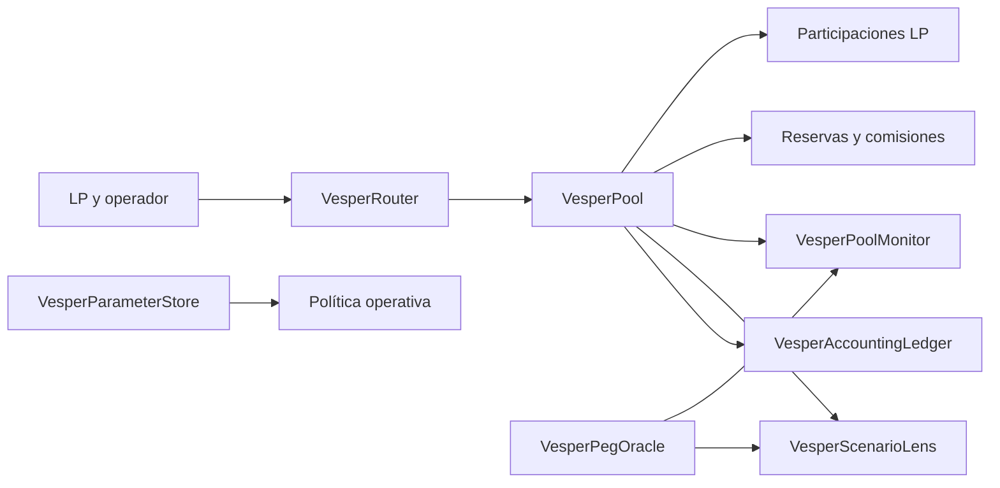

# VesperPoolProtocol



AMM de dos activos correlacionados implementado en Vyper 0.4.3. El pool conserva reservas activas y comisiones de protocolo por separado, emite participaciones LP y permite swaps, aportaciones y retiros. El repositorio incluye periphery, oráculo local, registro de parámetros, contabilidad y monitorización reproducible. No identifica fondos o despliegues de red.

## Arquitectura



`VesperPool` ejecuta la contabilidad y las transferencias. `VesperRouter` añade deadlines y lista de pools confiables. `VesperPoolLens`, `VesperPoolMonitor` y la nueva `VesperScenarioLens` son vistas: no autorizan ni ejecutan movimientos. El oráculo publica observaciones con heartbeat; el ledger guarda snapshots por época.

## Modelo económico

El invariante de dos reservas activas `x`, `y` usa `s=x+y`, media armónica `h=floor(2xy/s)`, bonificación `b=floor(h×amp/1000)` y dispersión `q=floor((x−y)²/s)`. Si `b>q`, `D=s+b−q`; en otro caso `D=s`. Los swaps resuelven la reserva destino mediante una búsqueda acotada. La participación LP depende de `D` y del suministro de shares. Las comisiones de protocolo se excluyen de reservas activas.

Para `x=y=1 000 000` y `amp=800`, `s=2 000 000`, `h=1 000 000`, `b=800 000`, `q=0` y `D=2 800 000` en las mismas unidades. En retiros por cesta, el coste de shares combina la caída de `D`, la distancia frente a una cesta proporcional y la profundidad armónica. Consulte [el modelo económico](docs/modelo-economico.md) para redondeos, comisiones y métricas.

## Inicio local

Requiere Python 3.12, Vyper 0.4.3 y titanoboa 0.2.8. Las versiones de prueba están fijadas en `requirements.txt`.

```bash
python -m venv .venv
source .venv/bin/activate
python -m pip install -r requirements.txt
python scripts/check_contracts.py
python -m ruff check tests scripts
python -m pytest -q
```

En PowerShell, active con `.\.venv\Scripts\Activate.ps1` o invoque directamente `.\.venv\Scripts\python.exe`. `bash scripts/ci.sh` reproduce compilación, estilo y pruebas en un entorno Unix.

## Escenarios de riesgo

`VesperScenarioLens.scenario(pool, oracle, withdraw0, withdraw1, shock0Bps, shock1Bps)` devuelve reservas restantes, valor antes/después, caída relativa, concentración y fecha de la observación más antigua. Los shocks son caídas de precio en puntos básicos, de 0 a 10 000. La función exige precios válidos y frescos; es una sensibilidad contable, no una simulación de ejecución ni un control de admisión.

## Documentación

- [Arquitectura y flujos](docs/arquitectura.md)
- [Invariante, comisiones y estrés](docs/modelo-economico.md)
- [Operación y validación](docs/operacion.md)
- [Controles de seguridad](docs/controles-seguridad.md)
- [Política de seguridad](SECURITY.md)
- [Historial de cambios](CHANGELOG.md)

La rama `production`, el tag anotado `v2.0.0` y el release se verifican contra el mismo commit de `main`. La publicación no implica un despliegue en red ni una auditoría externa.
