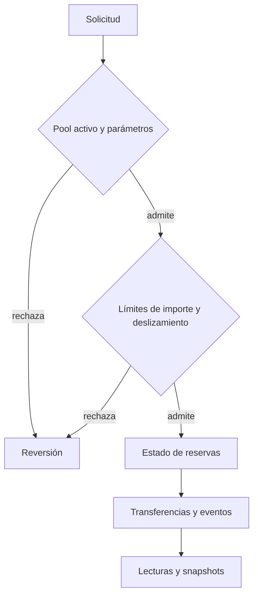

# Política de seguridad de VesperPoolProtocol

## Supuestos y límites

El pool está diseñado para dos ERC-20 estándar, sin rebases, comisiones de transferencia ni hooks. Las reservas se expresan en unidades mínimas y el modelo presupone precisión compatible entre ambos activos. El oráculo local usa precios 1e18 y heartbeat configurado; una cotización caducada no debe utilizarse para la vista de estrés.

Las funciones mutables principales aplican protección contra reentrada y comprueban destinatario e importes. El router impone deadlines y pools confiables. La política de riesgo y las lentes publican parámetros e indicadores, pero no sustituyen controles ejecutados por el pool.

## Invariantes de revisión

- `reserva activa = reserva registrada − comisión de protocolo` por token.
- Las shares LP emitidas y quemadas corresponden a cambios admitidos de liquidez.
- Un swap respeta la salida mínima declarada por el usuario.
- Una retirada respeta el máximo de shares y mínimos de activos.
- Los balances físicos y las reservas pueden reconciliarse tras `sync`.
- Un snapshot conserva época, suministro, reservas, fees, invariante y timestamp.
- Las vistas de estrés no mutan almacenamiento ni autorizan movimientos.

La reconciliación de saldos agregados no prueba por sí sola que cada transición económica individual sea correcta. Los cambios en el invariante, emisión LP o retiros requieren pruebas de rutas distintas, redondeos y activos sesgados.

## Avisos privados

Use el canal privado de avisos de seguridad de GitHub si está habilitado. Incluya commit, parámetros, entradas mínimas, resultado esperado/observado, impacto y reproducción local. No publique detalles sensibles ni utilice fondos o sistemas ajenos para una demostración.
