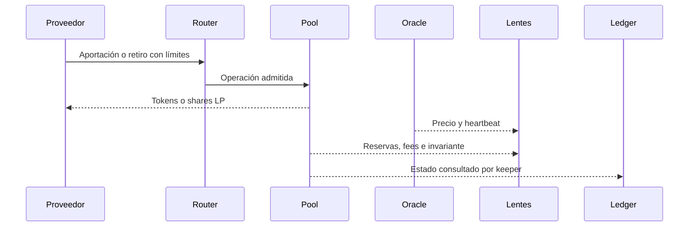

# Arquitectura y flujos

`VesperPool` mantiene dos reservas, fees segregadas, suministro LP, amplificación e invariante. `VesperRouter` agrupa llamadas con deadline y pools confiables. `VesperPoolLens` ofrece cotizaciones y posiciones; `VesperPoolMonitor` agrega salud de peg, concentración y liquidez; `VesperScenarioLens` aplica shocks de precio y retiros hipotéticos sin escribir estado. `VesperPegOracle` publica precios y frescura. `VesperAccountingLedger` registra checkpoints operativos por época.

Los roles de propietario, gobernador, keeper y reporter tienen alcance distinto. El monitor y las lentes son superficies de lectura; sus indicadores pueden apoyar decisiones operativas, pero no cambian las reglas del pool. El mock ERC-20 se utiliza en fixtures locales.

| Componente | Escribe | Consulta |
| --- | --- | --- |
| Pool | reservas, fees, LP | oráculo solo mediante módulos externos |
| Router | lista de pools | pool |
| Oráculo | precios y rondas | parámetros de heartbeat |
| Ledger | snapshots | pool |
| Lentes | nada | pool y oráculo |
