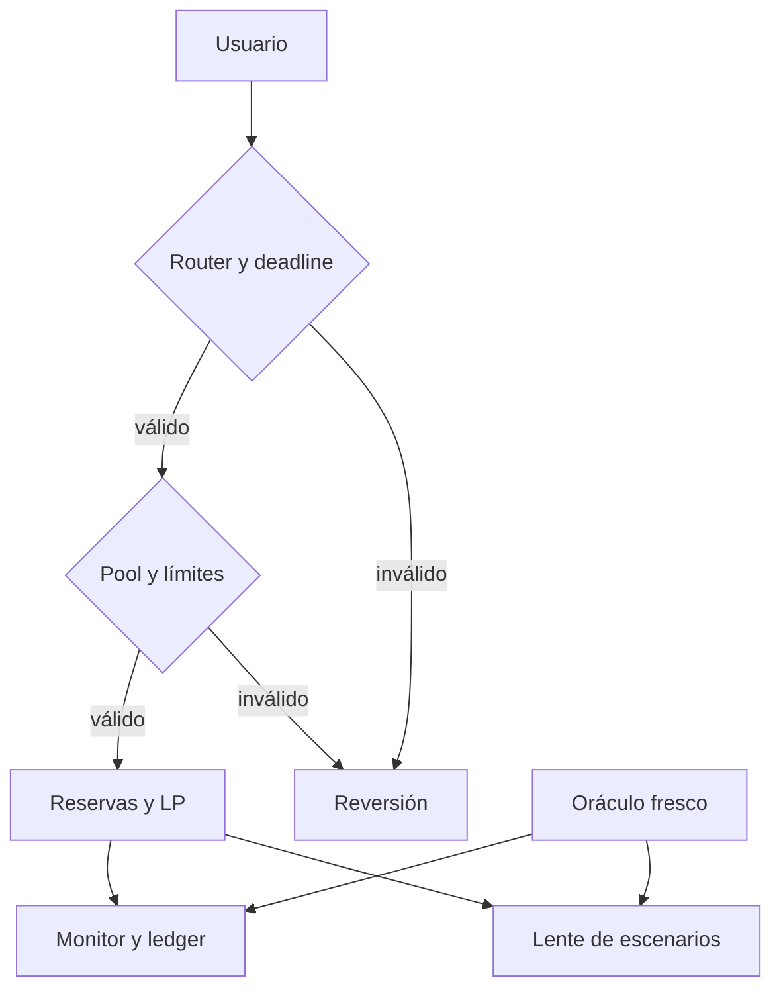

# Controles de seguridad

La superficie mutable del pool aplica pausas, controles de destinatario, límites de importe, protección contra reentrada y parámetros de fees. El router exige deadlines y pools confiables. El oráculo limita reporter, frescura y desviación por activo. El ledger requiere keeper para registrar snapshots. La política operativa publica umbrales, pero una vista o parámetro no es una autorización automática de ejecución.

Pruebas de regresión deben cubrir aportación inicial, pools sesgados, swaps en ambas direcciones, retiros balanceados y por cesta, límites de shares y slippage, acumulación y claim de fees, precios caducados y sincronización de reservas. Para cada cambio económico revise valor LP, reservas activas y balances físicos por separado.

La lente de escenarios solo evalúa shocks uniformes por activo y retiros hipotéticos. Su rechazo de precios caducados impide mostrar un escenario con una fuente no fresca, pero no determina si el pool puede ejecutarlo. CI, rama de producción, tag y release son estados verificables separados, no una auditoría externa.
