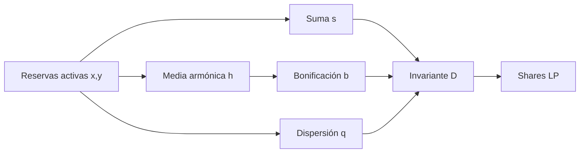

# Modelo económico

## Invariante y shares

Para reservas activas `x` e `y`, la función calcula `s=x+y`, `h=floor(2xy/s)`, `b=floor(h×amp/1000)` y `q=floor((x−y)²/s)`. El resultado es `D=s+b−q` cuando `b>q`, o `D=s` en caso contrario. En estado balanceado `x=y=1 000 000`, con `amp=800`, `D=2 800 000`. El redondeo entero de cada etapa forma parte de la semántica; no use aritmética flotante al comparar con el contrato.



Las comisiones de swap se registran en reservas; la parte del protocolo se contabiliza aparte y se excluye de la liquidez activa. `quoteAddLiquidity` y las vistas de retiro calculan shares o cestas con el estado consultado. La operación mutable aplica sus límites de usuario y produce eventos para reconciliación.

## Retiro por cesta

La quema base sigue la disminución del invariante con redondeo hacia arriba.
La penalización mide la distancia entre la cesta posterior y la cesta
proporcional que resultaría de escalar ambas reservas por `D_after/D_before`:

```text
idealᵢ = floor(oldᵢ × D_after / D_before)
distance = |new₀ - ideal₀| + |new₁ - ideal₁|
baseShares = ceil((D_before - D_after) × supply / D_before)
rawPenaltyShares = floor(floor(distance × penaltyBps / 10 000)
                         × supply / D_before)
```

El índice de profundidad armónica relaciona la media armónica con `D`:

```text
quality(x,y,D) = floor(floor(2xy/(x+y)) × 10 000 / D)
```

La liquidación aplica `rawPenaltyShares` cuando la calidad no disminuye; si
disminuye, escala la penalización por `quality_after/quality_before`. El total
de shares es la suma de quema base y penalización. La vista y la ejecución
comparten el mismo cálculo y el usuario limita el total con `max_shares`.
El parámetro de penalización está acotado por gobierno a 2 500 bps.

## Estrés de peg y liquidez

`VesperScenarioLens` toma precios frescos del oráculo y calcula valor a escala 1e18. Con reservas de 1 000 000 unidades por activo y precio uno, el valor inicial es 2 000 000. Si se proyecta retirar 100 000 del activo 0 y una caída de su precio del 10 %, quedan 900 000 y 1 000 000; el valor estresado es 1 810 000, caída de 950 puntos básicos. La concentración de valor es `floor(|valor0−valor1|×10 000 / valorTotal)`.

Esta sensibilidad supone activos con unidades compatibles y retirada instantánea hipotética. No estima slippage, tiempo de ejecución ni coste de salida. Para decisiones reales deben contrastarse precios, profundidad y estado de red externos.
